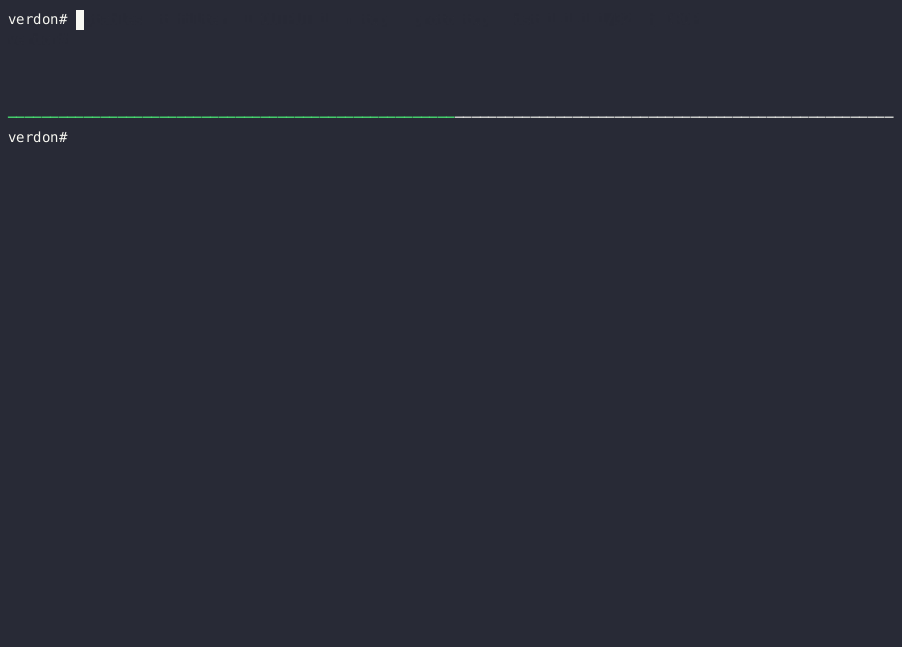

# pwru (packet, where are you?)

[](https://github.com/cilium/pwru/actions/workflows/test.yml)
[](https://github.com/cilium/pwru/releases/latest)


`pwru` is an [eBPF](https://ebpf.io)-based tool for tracing network packets in
the Linux kernel with advanced filtering capabilities. It allows fine-grained
introspection of kernel state to facilitate debugging network connectivity issues.

The following example shows where the packets of a `curl` request are dropped
after installing an IP tables rule:



## Running

### Requirements

`pwru` requires >= 5.3 kernel to run. For `--output-skb` >= 5.9 kernel is required. For `--backend=kprobe-multi` >= 5.18 kernel is required.

`pwru` optionally requires `debugfs`. It has to be mounted in `/sys/kernel/debug`. In case the folder is empty, it can be mounted with:

```
mount -t debugfs none /sys/kernel/debug
```

The following kernel configuration is required.

|           Option         | Backend      |                   Note                               |
| ------------------------ | -------------|----------------------------------------------------- |
| CONFIG_DEBUG_INFO_BTF=y  | both         | available since >= 5.3                               |
| CONFIG_KPROBES=y         | both         |                                                      |
| CONFIG_PERF_EVENTS=y     | both         |                                                      |
| CONFIG_BPF=y             | both         |                                                      |
| CONFIG_BPF_SYSCALL=y     | both         |                                                      |
| CONFIG_FUNCTION_TRACER=y | kprobe-multi | /sys/kernel/debug/tracing/available_filter_functions |
| CONFIG_FPROBE=y          | kprobe-multi | available since >= 5.18                              |

You can use `zgrep $OPTION /proc/config.gz` to validate whether option is enabled.

### Downloading

You can download the statically linked executable for x86\_64 and arm64 from the
[release page](https://github.com/cilium/pwru/releases).

### Usage

```
$ ./pwru --help

Usage: ./pwru [options] [pcap-filter]
    Available pcap-filter: see "man 7 pcap-filter"
    Available options:
      --all-kmods[=true|false]                     attach to all available kernel modules
      --backend string                             Tracing backend('kprobe', 'kprobe-multi'). Will auto-detect if not specified.
      --debug[=true|false]                         enable debug logging
      --filter-func string                         filter kernel functions to be probed by name (exact match, supports RE2 regular expression)
      --filter-ifname string                       filter skb ifname in --filter-netns (if not specified, use current netns)
      --filter-kprobe-batch uint                   batch size for kprobe attaching/detaching (default 10)
      --filter-mark mark[/mask]                    filter skb mark (format: mark[/mask], e.g., 0xa00/0xf00; default: 0/0; exact match if mask is omitted) (default 0x0/0x0)
      --filter-netns string                        filter netns ("/proc/<pid>/ns/net", "inode:<inode>")
      --filter-non-skb-funcs strings               filter non-skb kernel functions to be probed (--filter-track-skb-by-stackid will be enabled)
      --filter-skb-expr string                     filter skb with simple C expression, like 'skb->protocol == 0x0800'
      --filter-trace-tc[=true|false]               trace TC bpf progs
      --filter-trace-xdp[=true|false]              trace XDP bpf progs
      --filter-track-bpf-helpers[=true|false]      trace BPF helper functions
      --filter-track-skb[=true|false]              trace a packet even if it does not match given filters (e.g., after NAT or tunnel decapsulation)
      --filter-track-skb-by-stackid[=true|false]   trace a packet even after it is kfreed (e.g., traffic going through bridge)
      --filter-tunnel-pcap-l2 string               pcap expression for vxlan/geneve tunnel (l2)
      --filter-tunnel-pcap-l3 string               pcap expression for vxlan/geneve tunnel (l3)
      --filter-xdp-expr string                     filter xdp with simple C expression, like 'xdp->rxq->dev->ifindex == 9'
  -h, --help[=true|false]                          display this message and exit
      --kernel-btf string                          specify kernel BTF file
      --kmods strings                              list of kernel modules names to attach to
      --netns-names-max-length uint8               maximum number of chars to print per netns name (when not outputting JSON) (min 10) (default 16)
      --output-bpfmap[=true|false]                 print function arguments related to bpf maps
      --output-caller[=true|false]                 print caller function name
      --output-file string                         write traces to file (rotates at 100MB by default)
      --output-file-compress[=true|false]          compress rotated files with gzip
      --output-file-max-age int                    max age in days to keep rotated files (0, no limit)
      --output-file-max-backups int                max number of rotated files to keep (0, no limit)
      --output-file-max-size int                   max size in MB per file before rotation (default 100)
      --output-json[=true|false]                   output traces in JSON format
      --output-limit-lines uint                    exit the program after the number of events has been received/printed
      --output-meta[=true|false]                   print skb metadata (default true)
      --output-netns-names[=true|false]            print netns names where possible
      --output-skb[=true|false]                    print skb
      --output-skb-cb[=true|false]                 print skb->cb
      --output-skb-metadata strings                print skb metadata (e.g., "skb->mark", "skb->hash"), 4 at most
      --output-skb-shared-info[=true|false]        print skb shared info
      --output-stack[=true|false]                  print stack
      --output-tcp-flags[=true|false]              print TCP flags
      --output-tunnel[=true|false]                 print encapsulated tunnel header data
      --output-tuple[=true|false]                  print L4 tuple (default true)
      --output-xdp-metadata strings                print xdp metadata (e.g., "xdp->rxq->queue_index"), 4 at most
      --set-percpu-buf uint32                      set the size of buffers to print skb data (used by --output-skb and --output-skb-shared-info) (default 4096)
      --shirudo-available-funcs string             the target's available_filter_functions (default: this host's), as --kernel-btf is its BTF
      --shirudo-keys-dir string                    the shirudo operator's keys directory, with signing_key.pem and cert.der, to sign the upatch with
      --shirudo-name string                        the name of the shirudo upatch (default "pwru")
      --shirudo-upatch string                      instead of tracing, write to the given file a shirudo upatch that records the matching packets on its target
      --timestamp string                           print timestamp per skb ("current", "relative", "absolute", "none") (default "none")
      --version[=true|false]                       show pwru version and exit
```

The `--filter-func` switch does an exact match on function names i.e.
`--filter-func=foo` only matches `foo()`; for a wildcarded match, try
`--filter-func=".*foo.*"` instead.

### Running with Docker

Docker images for `pwru` are published at https://hub.docker.com/r/cilium/pwru.

An example how to run `pwru` with Docker:

```
docker run --privileged --rm -t --pid=host -v /sys/kernel/debug/:/sys/kernel/debug/ cilium/pwru pwru --output-tuple 'host 1.1.1.1'
```

### Running on Kubernetes

The following example shows how to run `pwru` on a given node:
```
#!/usr/bin/env bash
NODE=kind-control-plane
PWRU_ARGS="--output-tuple 'host 1.1.1.1'"

trap " kubectl delete --wait=false pod pwru " EXIT

kubectl apply -f - <<EOF
apiVersion: v1
kind: Pod
metadata:
  name: pwru
spec:
  nodeSelector:
    kubernetes.io/hostname: ${NODE}
  containers:
  - image: docker.io/cilium/pwru:latest
    name: pwru
    volumeMounts:
    - mountPath: /sys/kernel/debug
      name: sys-kernel-debug
    securityContext:
      privileged: true
    command: ["/bin/sh"]
    args: ["-c", "pwru ${PWRU_ARGS}"]
  volumes:
  - name: sys-kernel-debug
    hostPath:
      path: /sys/kernel/debug
      type: DirectoryOrCreate
  hostNetwork: true
  hostPID: true
EOF

kubectl wait pod pwru --for condition=Ready --timeout=90s
kubectl logs -f pwru
```

Also see [contrib/scripts/pwru-on-k8s-node](contrib/scripts/pwru-on-k8s-node) for a reusable version of this script.

### Exporting a shirudo upatch

On a [shirudo](https://github.com/shirudo-dev/shirudo) target, only signed BPF
loaders may load BPF programs, so `pwru` cannot trace there itself. With
`--shirudo-upatch`, `pwru` instead writes a signed upatch, which shirudo
verifies, loads and attaches on the target, and whose records it reads back:

```
operator$ pwru --shirudo-upatch pwru.upatch --shirudo-keys-dir ~/shirudo-keys \
              --kernel-btf vmlinux.btf --shirudo-available-funcs available_filter_functions \
              --filter-func '^(ip_output|__dev_queue_xmit|ip_rcv_core|sk_skb_reason_drop)$' \
              'host 10.0.0.1 and tcp port 443'
target#   shirudo upatch load pwru.upatch
target#   shirudo upatch map pwru events --json --peek
```

The keys directory is the one `shirudo genkey` wrote, and the upatch is named
`pwru` unless `--shirudo-name` says otherwise. Its loader, generated by
[ebpf-sl](https://github.com/cilium/ebpf-sl), is resolved for one kernel build
when it is exported: copy the target's `/sys/kernel/btf/vmlinux` and
`/sys/kernel/tracing/available_filter_functions` for `--kernel-btf` and
`--shirudo-available-funcs`, or the export takes those of the host it runs on.
The target needs `CONFIG_FPROBE=y`: every function is probed with
`kprobe.multi`.

Each record has the time, the skb, the function, the CPU, PID and command,
the netns, mark, ifindex, length and protocol, the tuple, the TCP flags, and
the reason of a drop at `sk_skb_reason_drop` or `kfree_skb_reason`. The log
holds 1024 records per export, and counts the rest as `overflow`;
`shirudo upatch map pwru events --otel` sends them to an OTLP collector and
empties the log, as the target's periodic export does. `--filter-func`,
`--filter-netns` (as `inode:<inode>`), `--filter-mark`, `--filter-skb-expr` and
the pcap filter go into the upatch; every other option is refused.

A directive signed with shirudo unloads it:

```
operator$ shirudo build --unload pwru -o pwru.unload.upatch --keys-dir ~/shirudo-keys \
              --payload-sha256 "$(shirudo upatch info --json pwru.upatch | jq -r .payload_sha256)"
target#   shirudo upatch unload pwru.unload.upatch
```

## Distro packages

`pwru` is available in some distro packages. [GH#89](https://github.com/cilium/pwru/issues/89) tracks any packaging work and progress.

[](https://repology.org/project/pwru/versions)

### Running on Vagrant

See [docs/vagrant.md](docs/vagrant.md)

## Developing

### Dependencies

* Go >= 1.16
* LLVM/clang >= 12
* Bison
* Lex/Flex >= 2.5.31
* libpcap(-dev)

### Building

```
make
```

Alternatively, you can build in the Docker container:

```
make release
```

### Sign-off

Ensure that all commits have [Developer Certificate of Origin](https://developercertificate.org/) by adding a [Signed-off-by line to your commit messages](https://docs.cilium.io/en/stable/contributing/development/contributing_guide/#developer-s-certificate-of-origin).

## Community

Join the `#pwru` [Slack channel](https://slack.cilium.io) to chat with
developers, maintainers, and other users. This is a good first stop to ask
questions and share your experiences.

## Logo Credits

The detective gopher is based on the Go gopher designed by Renee French.
